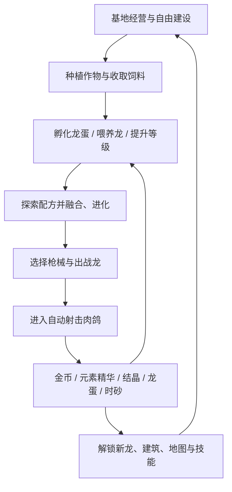

# 《原始龙族》游戏总体设计方案

> **文档版本**：V0.1｜总体设计基线  
> **项目名称**：《原始龙族》（暂定）  
> **游戏类型**：龙族培育与牧场经营 × 自由基地建设 × 自动射击肉鸽  
> **发行方式**：单机买断制，无充值、无付费加速、无体力收费  
> **目标平台**：PC（Steam）＋移动端（Android / iOS），统一横屏  
> **开发引擎**：Unreal Engine 5（UE5）；蓝图优先，必要时使用 C++ 优化  
> **美术定位**：Q版龙族、明亮手绘的2.5D视觉、简洁圆润的木质UI  
>
> 本文为**总体游戏设计与技术方向文档**，不包含开发日程、工作周数、交付日期或人力排期。所有带数值的内容为**首轮可测试方案**，应根据试玩体验调整。

---

## 1. 项目概述

### 1.1 一句话介绍

玩家在一座可以自由规划的大型原始龙族牧场中，种田、孵化龙蛋、喂养与融合不同属性的龙；再带着自己培养的龙进入俯视角自动射击肉鸽关卡，获得新龙蛋、稀有材料和建设资源，逐步建立属于自己的龙族部落。

### 1.2 核心体验

1. **拥有自己的龙**：孵出幼龙，观察它在牧场中走动、玩耍、睡觉，进行喂养与培养。
2. **发现新龙**：风龙＋雷龙＝风暴雷龙；融合产生新的外观、技能机制与收集目标。
3. **建设自己的基地**：玩家控制角色自由移动，也能切换建造模式，自由摆放与调整建筑、农田、道路、围栏和龙舍。
4. **让养成成果用于战斗**：携龙参加自动射击肉鸽，龙会改变枪械弹道、元素反应和整局构筑方向。
5. **经营与冒险相互推动**：农场稳定产出基础材料；肉鸽提供稀有资源和游戏内加速道具，减少不必要的等待。
6. **买断制的完整体验**：靠探索、成长、收集和布局获得乐趣，而非充值、活动红点与强制每日登录。

### 1.3 核心设计支柱

| 支柱 | 设计要求 | 避免的问题 |
|---|---|---|
| 龙族是主角 | 龙是可互动宠物、可收藏物种、可培养战斗伙伴 | 变成只有属性加成的装备 |
| 融合产生新玩法 | 融合龙有独立视觉与技能机制 | 只把两条龙的数值相加 |
| 自由规划基地 | 大片连续土地、自由放置与扩张 | 固定建筑点位、只能点菜单 |
| 战斗易上手且有构筑 | 移动＋自动射击＋升级三选一 | 高操作门槛或纯数值挂机 |
| 等待可被游玩替代 | 时间自然流逝，冒险也能加速 | 人为拖延、强迫反复刷材料 |
| 纯净的买断体验 | 无付费货币、无抽卡付费、无付费加速 | 免费手游式运营负担 |

### 1.4 玩法优先级

**核心：龙蛋 → 孵化 → 喂养成长 → 融合/进化 → 带龙冒险 → 带回资源。**  
**重要支撑：农田生产、龙舍布局、自由建造与领地扩张。**  
**后续扩展：龙族生态互动、更多融合配方、多进化分支、不同冒险地图与挑战。**

---

## 2. 游戏世界与玩家身份

### 2.1 世界观

世界处于架空的原始奇幻时代。人类部落与远古龙族共存，玩家是一个新兴龙族牧场的经营者与探险者。古代遗迹中留存着能够利用龙族晶石发射弹丸的**原始枪械/遗迹枪械**，因此枪械肉鸽与原始部落的美术风格能够统一。

- 基地：阳光草地、木材、兽骨、石雕、低矮山丘与属性龙舍。
- 龙族：以风、雷、火、冰为起点，逐渐发现混合属性和特殊龙种。
- 野外：林地、峡谷、湿地、火山与遗迹，各有不同的敌人和元素资源。
- 枪械：兽骨枪、晶石机枪、龙骨霰弹枪、遗迹狙击枪等；外观体现原始工艺与奇幻科技的结合。

世界观以轻松冒险为主，不使用沉重写实或过度黑暗的叙事气质。

### 2.2 玩家目标

**短期目标**：收获饲料、孵化龙蛋、首次融合、完成一次冒险。  
**中期目标**：建设更大的牧场，收集基础属性与融合龙，解锁更多枪械/关卡/建筑。  
**长期目标**：完成龙族图鉴、研究隐藏配方、培养进化分支、自由设计有个人特色的龙族基地、挑战更复杂的战斗构筑。

---

## 3. 美术与UI规范

### 3.1 各参考游戏如何取长处

| 参考 | 提取的优点 | 不照搬的部分 |
|---|---|---|
| 《龙之牧场》 | Q版龙造型、属性栖息地、孵蛋与培育期待感、龙图鉴 | 老式页游UI、付费加速、冗长点击流程 |
| QQ农场 | 种植—等待—收获的轻松经营、土地规划、明确的产出反馈 | 必须定时上线和重复劳动 |
| 《部落冲突》 | 大面积基地、建筑自由摆放、拖动与重新规划的空间感 | PvP掠夺、建筑摧毁、长时间升级墙 |
| 《王国保卫战》（Kingdom Rush） | 明快手绘、夸张圆润造型、木质/羊皮纸UI、清晰的交互反馈 | 过多厚重边框、过度复杂的常驻HUD |
| 《饥荒》 | 少量手绘线条、2D插画轮廓与轻微旋转透视感 | 阴暗怪诞配色和密集交叉线 |
| 《弹壳特攻队》《吸血鬼幸存者》 | 移动走位、自动攻击、怪潮、随机三选一、构筑爆发 | 商业化入口与重付费成长结构 |

### 3.2 统一视觉定义

**“龙之牧场的Q版亲和力 + 王国保卫战的圆润手绘感 + 少量饥荒式插画线条”。**

- **场景**：明亮、清爽、草地留白较多；道路与建筑之间保持足够空间。
- **龙**：头略大、身体圆润、角/翅膀/尾巴特征清晰，每种属性有独立剪影和主色。
- **建筑**：木头、石头、布棚、骨饰、彩色晶体；比例偏玩具化，屋顶厚实且轮廓易读。
- **角色**：Q版小人物，动作夸张、明显；俯视下也能认清方向。
- **轮廓**：适度深色线条，避免全屏粗黑描边；线条厚度随着物件大小统一。
- **特效**：风、火、冰、雷具有明确形状语言；高频肉鸽技能优先保证敌人、主角、伤害区域仍可辨认。
- **地图密度**：保持空地和草地，基地初期不应被建筑和装饰挤满。

### 3.3 配色建议

| 用途 | 色彩 | 建议值 |
|---|---|---|
| 基地主色 | 草地绿 | `#77A94F` |
| 建筑/UI木框 | 温暖木棕 | `#A66A39` |
| 对话/说明面板 | 浅羊皮纸 | `#F0D7A5` |
| 主要交互按钮 | 暖琥珀橙 | `#D99549` |
| 水、冰和科技点缀 | 湖蓝 | `#6695BB` |
| 重要文字 | 深棕 | `#493722` |

### 3.4 画面实现方式

- **视觉目标**：2D插画感的2.5D卡通游戏。
- **技术实现**：UE5里的轻量3D场景/角色/建筑/龙，使用手绘贴图与简化材质；UI为UMG 2D贴图。
- **基地镜头**：固定方向的斜俯视相机，镜头可拉近/拉远；默认不让玩家自由绕场景旋转。
- **战斗镜头**：接近正上方的斜俯视，角色周围有足够的预判空间。
- **禁止倾向**：写实PBR光影、高成本全屏描边、过多闪光粒子、厚重3D手游UI。

### 3.5 横屏UI规范

统一横屏，分别支持鼠标键盘与触屏/虚拟摇杆。布局随屏幕安全区缩放，而不是简单把PC界面缩到手机大小。

**基地常驻界面**：
- 左上：玩家信息、当前基地等级（简洁）。
- 顶部：金币与饲料，其他材料收纳在背包或可展开资源页。
- 右上：地图/设置/菜单。
- 底部或右下：建造、龙族、背包、冒险等少量入口。
- 点击建筑：就近弹出对应面板，不让多个浮窗同时占据画面。

**战斗常驻界面**：
- 左上：血量、等级、经验或紧凑状态区。
- 顶中：时间、关卡/波次。
- 右上：暂停。
- 角落：龙技能状态；大面积区域留给战斗本身。
- 升级时暂停或减速，居中显示清晰的三选一卡片。

**明确不做**：充值、战令、签到红点、体力购买、限时礼包和广告加速按钮。

---

## 4. 两种主要游戏场景

### 4.1 基地：自由经营大牧场

基地不是固定菜单大厅，而是连续、可以走动与建设的游戏空间。玩家可进入两种互补模式。

#### A. 探索/交互模式

- 主角可在基地中自由移动：PC使用WASD，手机使用左侧虚拟摇杆。
- 靠近龙可查看、喂食、抚摸、召唤跟随；龙有简单闲逛/睡觉/吃饭行为。
- 靠近孵化巢、农田、融合祭坛、冒险营地可交互。
- 建筑占据真实空间；玩家和龙能够绕过建筑行走。

#### B. 自由建造模式

- 点击建造按钮（PC可设置快捷键 `B`），镜头提高并拉远。
- 显示网格、已解锁区域边界和当前可摆放建筑列表。
- 建筑可拖动、移动、旋转、收回；示意首版采用90°旋转与网格吸附。
- 有效位置显示绿色轮廓，无效位置显示红色轮廓并说明原因。
- 建筑不可放在未解锁土地、其他建筑占用格、必要通道和关键出生点上。
- 移动既有建筑原则上免费；避免因反复规划额外消耗玩家资源。
- 道路、围栏和装饰可自由组合；道路主要承担美观与导向作用，不强制形成唯一有效路线。

#### C. 领地扩张

- 初始可用一块开阔草地，外围为待解锁区域。
- 通过金币、特定建设材料、冒险探索奖励解锁相邻地块。
- 土地扩张带来更多农田、属性龙舍和装饰空间，不引入PvP攻防。
- 建筑数量与实际渲染性能受控制；大牧场视觉上应宽敞、不拥挤。

### 4.2 冒险：自动射击肉鸽

- 玩家控制人物移动，不需要手动持续开枪。
- 枪械自动寻找有效敌人并攻击；龙跟随并自动释放技能。
- 怪物掉落局内经验；升级时三选一，从武器、龙能力、生存强化中构筑。
- 局内技能与随机事件只在当前关卡生效。
- 胜利或失败后返回基地，按目标完成度结算可带回的养成奖励。
- 普通完整关卡以约**10分钟**为测试基准，可根据地图类型调整；不要让每局都过长。

---

## 5. 核心循环



**不可违反的循环原则**：任何时刻玩家至少有一个有意义的选择——经营、整理牧场、研究图鉴、培养另一条龙或直接冒险。等待不能成为唯一可做的事。

---

## 6. 龙族系统

### 6.1 龙的静态定义与实例

一种龙的“物种配置”与玩家拥有的“某条龙实例”必须分开。

**物种配置**（例如风龙）：ID、名字、元素、稀有度、模型/动画、基础战斗机制、技能池、成长曲线、融合标签、进化方向。  
**实例数据**（例如玩家的第2条风龙）：唯一ID、物种ID、等级、培养经验、亲密度、进化分支、展示名字、出战/驻扎状态。

这可支持同物种多条龙，但不要把重复培养设成强制劳动。

### 6.2 第一批龙族

| 龙种 | 属性 | 经营表现 | 战斗特色 |
|---|---|---|---|
| 风龙 | 风 | 喜欢在草地跑动，可触发风系农场互动 | 风刃、轻度聚怪、弹道偏移 |
| 雷龙 | 雷 | 触碰晶石时放电 | 感电、连锁闪电 |
| 火龙 | 火 | 会在取暖点休息 | 燃烧、范围爆炸 |
| 冰龙 | 冰 | 喜爱水边与冰晶装饰 | 减速、冻结、碎裂 |
| 风暴雷龙 | 风＋雷 | 小范围雷云/旋风表演 | 雷暴旋风、聚怪＋连锁 |
| 烈焰风暴龙 | 风＋火 | 尾部有温和的火焰风涡 | 火旋风、传播燃烧 |
| 霜雷龙 | 冰＋雷 | 身边有电光冰晶 | 冻结目标触发雷击碎裂 |

### 6.3 孵化

- 冒险、探索事件、首通奖励及图鉴任务提供龙蛋。
- 把龙蛋放入孵化巢，启动离线持续的孵化计时。
- 时间完成后点击领取，播放简短破壳演出，龙进入仓库并可放置到牧场。
- 已知龙蛋品质对应大致范围；不要让玩家完全不知道结果或没有稳定获得目标龙的路径。
- 新手第一颗普通龙蛋应快速完成，让玩家尽早体验养龙。

**初版时间表（待试玩验证）**：

| 品质 | 基础孵化时间 | 备注 |
|---|---:|---|
| 普通 | 3分钟 | 第一条龙可通过引导进一步缩短 |
| 稀有 | 15分钟 | 适合边经营边冒险 |
| 史诗 | 60分钟 | 中期可选目标 |
| 传说 | 120分钟 | 长期收集，不能阻挡主线 |

**孵化巢升级示例**：1级1槽；2级2槽；3级孵化速度提高20%。速度调整使用统一公式，不让每颗蛋因UI刷新改变结束时间。

### 6.4 喂养、亲密度与成长

区分两个动作：

1. **日常喂食/互动**：提供宠物感与亲密度，动作反馈优先，操作不要求短时间内狂点。
2. **成长培养**：消耗饲料、金币及后期元素精华来升级，获得技能变化与少量属性成长。

**基础龙Lv.1—10建议消耗**：

| 从等级升至 | 饲料 | 金币 | 对应元素精华 |
|---|---:|---:|---:|
| Lv.2 | 25 | 30 | 0 |
| Lv.3 | 45 | 50 | 0 |
| Lv.4 | 70 | 80 | 0 |
| Lv.5 | 100 | 120 | 0 |
| Lv.6 | 160 | 180 | 4 |
| Lv.7 | 240 | 250 | 6 |
| Lv.8 | 360 | 350 | 10 |
| Lv.9 | 520 | 500 | 15 |
| Lv.10 | 750 | 700 | 25 |

**成长奖励**：Lv.1拥有基础技能；Lv.3可参与基础融合；Lv.5解锁被动机制；Lv.8解锁进化方向；Lv.10获得觉醒或独特外观。具体里程碑可随龙种调整。

高等级优先解锁新的玩法选择，避免永久攻击力无限膨胀。亲密度以动作、装饰、可选被动为主要反馈，不制造必须每日喂养的惩罚。

### 6.5 融合

**原则：固定物种配方 + 配方探索 + 确定性成功。**

- 选择两条达到融合条件的父代龙。
- 支付元素精华、融合结晶和金币，经过融合计时，得到新龙。
- **父代龙保留**，不因融合消失；鼓励试验与收集。
- 首次发现配方解锁图鉴与新战斗流派。
- 未知配方可显示剪影/元素线索，不必一开始完全公开。
- 融合结束直接获得幼龙，不再叠加第二轮强制孵蛋倒计时。

**融合配方首轮数值**：

| 结果 | 前置 | 元素精华 | 融合结晶 | 金币 | 融合耗时 |
|---|---|---|---:|---:|---:|
| 风暴雷龙 | 风龙Lv.3 + 雷龙Lv.3 | 风20＋雷20 | 3 | 350 | 10分钟 |
| 烈焰风暴龙 | 风龙Lv.3 + 火龙Lv.3 | 风25＋火25 | 4 | 500 | 20分钟 |
| 霜雷龙 | 冰龙Lv.3 + 雷龙Lv.3 | 冰30＋雷30 | 5 | 700 | 30分钟 |

**设计红线**：融合龙应偏向不同战术，不应让基础龙全部失去战斗价值。例如风龙最强聚怪、雷龙最强单体连锁，风暴雷龙兼顾聚怪与群伤但有技能冷却或范围限制。

### 6.6 进化

- 融合是**产生新物种**；进化是**改变同一物种的成长形态与机制**。
- 第一批高阶进化采用分支选择，如风暴雷龙可进化成“飓雷领主”（控制向）与“毁灭雷龙”（爆发向）。
- 进化消耗专属材料、等级或挑战完成条件，而不是无限等待。
- 建议允许通过有限材料重置进化分支；不强迫玩家重新培养一条稀有龙才能换打法。

### 6.7 龙在基地的行为

建议统一支持：闲逛、驻足观察、睡觉、进食、被抚摸反馈、靠近相同属性装饰时的互动、玩家靠近时转头或跑来。首版只需要少量可重复组合的动画状态。

**长期可扩展**：龙驻扎农田/建筑获得小幅经营加成，但有槽位和收益上限；不能靠无限养重复龙产生无限收益。

---

## 7. 农场与基地经营

### 7.1 基地建筑分类

| 类别 | 代表建筑 | 功能 |
|---|---|---|
| 养龙 | 龙舍/属性龙巢 | 安置、展示龙，查看状态 |
| 培育 | 孵化巢 | 孵化龙蛋、扩展槽位 |
| 融合 | 融合祭坛 | 发现配方、融合新龙 |
| 种植 | 农田 | 生产饲料和特殊作物 |
| 冒险 | 冒险营地 | 选择关卡、枪械和出战龙 |
| 基础设施 | 仓库、路牌、围栏、道路 | 整理空间、资源管理、装饰 |
| 特殊建筑 | 研究石碑、元素设施 | 中后期解锁进化与特殊产出 |

### 7.2 自由建造规则

- 建筑配置包含尺寸（宽×高格）、图标、摆放条件、费用、占地与可交互组件。
- 可拖放、旋转90°、撤回、移动、入库。
- 建筑放置成功后写入建筑实例列表，离开/重启仍保留布局。
- 首版不做建筑受到怪物攻击或破坏。
- 放置移动不影响建筑内部完成中的孵化/种植任务。
- 解锁土地、装饰、龙巢、农田带来长期布局目标；不要强制让玩家遵守唯一最优布局。

### 7.3 农作物数据

初始4块农田，随着扩建增加到8—12块（建议目标，须根据UI与画面密度调整）。

| 作物 | 生长时间 | 每块种子成本 | 收获 | 用途 |
|---|---:|---:|---|---|
| 嫩草 | 3分钟 | 5金币 | 15饲料 | 快速补给 |
| 甜浆果 | 12分钟 | 25金币 | 70饲料 | 常规养龙 |
| 星露草 | 45分钟 | 60金币 | 220饲料＋1星露花蜜 | 高阶培养 |

**关键经营规则**：

- 作物成熟不会枯萎；离线时间照常计算。
- 玩家可以手动收获与播种，后续解锁批量功能减少重复点击。
- 不要求每天登录；未领取收益不会清零。
- 至少保留一种不会导致“没钱买种子”的恢复方式，例如初始基础种子免费或小游戏任务提供基础资源。
- **首版不设计偷菜、社交索取、强制在线交易。**

### 7.4 基地经济定位

农场负责**稳定饲料**，冒险负责**金币与稀有资源**。这样玩家想培养龙时有两条可并行的行动路径，而不是战斗或农场任何一方完全取代另一方。

---

## 8. 资源经济、等待与加速

### 8.1 五种核心资源

| 资源 | 主要来源 | 主要消耗 |
|---|---|---|
| 部落金币 | 冒险、任务、少量经营活动 | 种子、建筑、龙升级、融合 |
| 龙饲料 | 农田收获 | 喂养、升级 |
| 元素精华（风/雷/火/冰） | 对应属性关卡与敌人 | 龙族成长、融合、进化 |
| 融合结晶 | Boss、首通、挑战目标 | 融合、高阶进化 |
| 时砂 | 冒险完成、探索与目标奖励 | 加速孵化、融合、生产 |

**建筑木材/石料、龙蛋、图纸、特殊花蜜**等作为背包材料，不必全部升级为常驻货币栏。

### 8.2 时砂规则（买断制游戏内加速）

- 1个时砂 = 减少5分钟剩余计时。
- 默认每次普通肉鸽完整通关保底1个。
- 可用于孵化、融合与农田生长。
- 单个生产任务使用时砂的总加速额度不得超过该任务**计算后基础总时长的50%**。
- 普通3分钟龙蛋不建议用时砂；避免出现浪费道具的操作。
- 加速显示预计节省时间，并在确认前告知消耗。
- 时砂不可购买、不可看广告获取；完全由游戏内内容产出。

**计算约定**：任务开始时先应用建筑速度加成，得到本次基础持续时间；之后自然时间流逝和时砂抵扣分别记录。实际剩余时间向下限0取整。允许玩家随时退出游戏，回来领取已完成结果。

### 8.3 等待时间的设计边界

- 关键新手主线不应被长时间孵化卡住。
- 传说蛋/特殊进化允许有较长等待，但玩家可以同时做别的经营与战斗。
- 没有付费跳过、随机广告加速与登录倒计时惩罚。
- 重要融合完成后立即能出战，不再叠加无意义等待。
- 时砂获得量必须稳定，不能成为另一种稀缺“付费货币替身”。

---

## 9. 自动射击肉鸽战斗

### 9.1 基础操作

- 俯视角/斜俯视横屏战场；玩家主要控制移动。
- 自动锁定合适目标并射击，初期不要求精确瞄准。
- 拾取经验升级，每次三选一；有少量刷新机会。
- 龙作为跟随伙伴，持续提供子弹附魔或自动技能。
- 首版建议**1条主战龙**，后续扩展副战/辅助龙槽位，避免画面拥挤。
- 可在后续添加一键释放龙终极技，但不要以操作复杂度作为首版卖点。

### 9.2 武器定位

| 武器 | 操作表现 | 更适合的龙/流派 |
|---|---|---|
| 原始机枪 | 快速连续射击 | 感电、燃烧叠层、持续触发 |
| 龙骨霰弹枪 | 近距散射、多弹丸 | 旋风聚怪、爆燃 |
| 遗迹狙击枪 | 低频高伤、穿透 | 冻结碎裂、单点爆发 |

枪械决定攻击节奏与子弹形态，龙决定元素机制；避免出现两套完全重复的技能升级系统。

### 9.3 元素机制

**攻击链路**：枪械命中 → 附加元素状态 → 龙技能触发 → 元素反应 → 局内升级放大。

| 元素组合 | 反应名 | 机制方向 |
|---|---|---|
| 风＋雷 | 雷暴 | 聚怪区域周期性放电 |
| 风＋火 | 火旋风 | 吸附并传播燃烧 |
| 风＋冰 | 极寒风暴 | 范围减速并积累冻结 |
| 火＋雷 | 爆燃 | 感电目标受到火伤后触发爆发 |
| 火＋冰 | 热冲击 | 消耗冻结，造成范围伤害 |
| 冰＋雷 | 霜雷碎裂 | 雷电命中冻结目标产生碎片 |

区分**局内临时元素反应**与**局外永久融合龙**：
- 普通风龙在某一局学到雷属性技能，可以临时触发基础雷暴。
- 永久拥有风暴雷龙，才可获得它专属的雷暴形态、升级池、觉醒和进化分支。

### 9.4 局内随机强化

三类升级池：

1. **枪械类**：射速、多弹丸、穿透、反弹、弹道变化、暴击。
2. **龙族类**：元素附着、范围、连锁、召唤数量、独特反应。
3. **生存类**：生命、防御、移速、拾取范围、经验效率。

每次升级提供3个选项。为减少极端坏运气，可以提高与当前枪械/龙流派相关选项的出现权重，而不是每次必给最强技能。

**风暴雷龙示例构筑**：

原始机枪 → 感电子弹 → 风眼牵引 → 电弧传导 → 雷云复制 → 终极“永恒雷暴”。

融合龙不是简单比基础龙伤害更高，而是提供另一套可理解、可观察的机制与技能成长过程。

### 9.5 关卡与敌人

首轮内容以以下方向建立差异：

| 关卡方向 | 环境 | 主要掉落 | 怪物特色 |
|---|---|---|---|
| 绿野部落边境 | 草地、木栅栏、兽骨障碍 | 基础龙蛋、风/火素材 | 大量轻型近战怪 |
| 雷鸣山谷 | 破碎石柱、晶石 | 雷精华、结晶 | 快速突进、电能敌人 |
| 遗迹湿地 | 浅水、遗迹、毒雾 | 特殊种子、进化道具 | 缓速区、范围怪 |

关卡目标除生存倒计时，还可包含击败Boss、收集遗迹核心、护送龙蛋等。内容扩展以**关卡策略和资源目标**为主，不只是提高敌人生命值。

### 9.6 奖励结算与失败反馈

**普通完整通关（约10分钟）的测试数值**：

| 奖励 | 数量 | 发放约定 |
|---|---:|---|
| 部落金币 | 200 | 通关基准奖励 |
| 指定元素精华 | 12 | 依关卡属性或选择的悬赏类型 |
| 融合结晶 | 1 | Boss/关底奖励 |
| 时砂 | 1 | 完整通关保底 |
| 普通龙蛋线索 | 1 | 累计3份可合成1颗普通龙蛋 |

- 首通、指定目标可提供额外的**保底指定龙蛋**，避免前期卡物种。
- 战败按存活时间、击杀进度返还部分金币与元素精华；Boss结晶和完整通关奖励不保证获得。
- 不设置付费复活、付费刷新升级和广告奖励翻倍。

---

## 10. 前期经济闭环校验

### 10.1 首次融合的可验证目标

**目标体验**：玩家不需要充值、不依赖极低概率掉落，也能通过农场与冒险融合出第一条风暴雷龙。

**示例初始条件**：
- 开局有200金币、1颗风龙蛋、4块农田、1个孵化槽。
- 首次通关保底获得1颗雷龙蛋（额外新手奖励，不占常规线索池）。
- 玩家完成4次常规冒险，选择2次风资源、2次雷资源。
- 玩家进行1轮4块甜浆果农田的收获。

**产出/消耗计算**：

| 项目 | 结果 |
|---|---|
| 初始金币 + 4次通关 | 200 + 4×200 = 1,000金币 |
| 4块甜浆果种植 | 消耗4×25 = 100金币；收获4×70 = 280饲料 |
| 风龙、雷龙分别升至Lv.3 | 共消耗140饲料、160金币 |
| 4次通关元素奖励 | 风24、雷24 |
| 4次通关融合结晶 | 4枚 |
| 风暴雷龙融合 | 消耗350金币、风20、雷20、3结晶 |
| 完成以上后剩余 | 390金币、140饲料、风4、雷4、1结晶 |

另可获得4个时砂。若使用1个时砂，可将本次10分钟融合中的5分钟抵扣。玩家实际体验还受自然等待、对局胜负、教程节奏影响。

**设计意图**：第一条融合龙作为明确的早期目标；具体完成时长需根据真实试玩验证，不以“强制刷满若干小时”为目标。

### 10.2 需要重点观察的卡点

- 玩家是否缺金币到无法播种（必须避免死锁）。
- 玩家是否已满足其他材料却长期缺某单一元素。
- 融合前置条件是否说明清楚、能不能追踪材料来源。
- 肉鸽失败会不会造成“白打”的挫折。
- 玩家刚获得融合龙，是否愿意立刻重新进入冒险验证技能。
- 基地放置越来越自由时，是否出现过密、难寻路与视觉混乱。

---

## 11. 玩家体验流程与UI页面

### 11.1 主流程

1. 进入基地，学会移动与查看四周。
2. 接触孵化巢，领取并孵化风龙蛋。
3. 将风龙安置在龙舍，种植并收获第一批饲料。
4. 喂养风龙，认识等级和技能。
5. 前往冒险营地，带风龙进入自动射击关卡。
6. 完成首次冒险，获得雷龙蛋、金币、元素素材。
7. 培养风龙与雷龙，使用融合祭坛发现风暴雷龙。
8. 体验新龙出战，再回到基地继续经营与规划。

### 11.2 主要页面

| UI页面 | 最重要的信息 |
|---|---|
| 基地主界面 `WBP_BaseHUD` | 世界可见、资源、少量入口 |
| 建造页 `WBP_BuildMode` | 建筑列表、占地预览、旋转、确认/取消 |
| 孵化页 `WBP_Hatchery` | 龙蛋、槽位、结束时间、领取、时砂 |
| 龙族列表 `WBP_DragonList` | 图鉴、属性过滤、收藏与出战 |
| 龙详情 `WBP_DragonDetail` | 3D龙展示、等级、喂养、技能、互动 |
| 融合页 `WBP_Fusion` | 父代选择、材料条件、产出预览、融合按钮 |
| 进化页 `WBP_Evolution` | 分支、前置条件、能力变化 |
| 冒险选择 `WBP_Adventure` | 地图、推荐属性、主要资源、出战准备 |
| 战斗HUD `WBP_BattleHUD` | 血量、经验、关卡进度、龙技能、暂停 |
| 升级选择 `WBP_LevelUp` | 三选一、清晰的强化差异 |
| 结算 `WBP_Result` | 战斗评价、资源、图鉴/培养进度、返回基地 |

### 11.3 新手引导要求

- 引导必须直接操作场景，不用连续弹出大量文字教程。
- 首次孵化、首次收获、首次融合与首次带龙战斗各有一次明确反馈。
- 只引导当前需要的信息；稀有等级、进化分支等晚些开放。
- 所有材料都应支持“查看来源”入口。

---

## 12. UE5总体技术设计

### 12.1 技术决策

**当前推荐**：UE5蓝图项目起步；基础玩法、基地、孵化、融合、UI和少量敌人先由蓝图完成。大量怪物逻辑、密集命中/伤害计算、对象池等出现性能瓶颈时，再针对性改成C++或批量管理方案。

**原因**：团队已经熟悉UE5工作方式的方向，项目核心复杂度首先在玩法闭环，不在是否一开始就用原生代码。

### 12.2 推荐数据层

| 数据 | 推荐实现 | 关键字段 |
|---|---|---|
| 龙物种 | `DA_DragonDefinition` / Primary Data Asset | DragonID、属性、模型、技能、成长配置 |
| 龙实例 | `FDragonInstance`（Struct） | InstanceID、DragonID、Level、亲密度、进化分支 |
| 龙蛋实例 | `FDragonEggInstance` | EggID、品质、孵化结果或结果池、状态 |
| 作物 | `DT_Crops`（DataTable） | CropID、生长时长、种子价格、产出 |
| 融合配方 | `DT_FusionRecipes` | 父代ID、结果ID、资源、耗时、前置 |
| 建筑 | `DA_BuildingDefinition` | 占地、模型、功能、摆放条件、费用 |
| 建筑实例 | `FBuildingInstance` | InstanceID、建筑ID、格坐标、旋转、状态 |
| 关卡奖励 | `DT_StageRewards` | StageID、产出类型、通关奖励、失败返还 |
| 玩家长期状态 | `SaveGame` | 库存、龙仓库、图鉴、建筑布局、计时器 |

### 12.3 主要蓝图与职责

```text
Content/DragonRanch/
├── Maps/
│   ├── L_Base                  # 基地
│   └── L_Battle_Test           # 肉鸽测试地图
├── Blueprints/
│   ├── Characters/
│   │   └── BP_PlayerCharacter  # 移动与互动
│   ├── Building/
│   │   ├── BP_BuildManager     # 网格放置和移动
│   │   ├── BP_BuildingBase     # 建筑共同功能
│   │   ├── BP_Hatchery         # 孵化建筑
│   │   ├── BP_FarmPlot         # 农田
│   │   └── BP_FusionAltar      # 融合祭坛
│   ├── Dragon/
│   │   ├── BP_DragonBase       # 牧场中的龙
│   │   └── BP_DragonCompanion  # 战斗随从龙
│   └── Battle/
│       ├── BP_EnemyBase
│       ├── BP_WeaponComponent
│       └── BP_DragonSkillComponent
├── Data/
│   ├── Dragons/
│   ├── Buildings/
│   ├── Crops/
│   └── Battle/
├── Input/
├── UI/
├── Materials/
├── Audio/
└── Save/
```

**原则**：不要为每条龙复制一整套蓝图；用“数据配置＋基础类＋具体技能/表现组件”实现差异。

### 12.4 基地建造逻辑

- 用网格坐标保存建筑位置，而不仅仅保存临时的世界坐标。
- 建造时根据射线/投影取得指针落点，再吸附到对应格子。
- 建筑定义保存占地宽高；旋转90°时交换占地宽高。
- 放置前验证边界、地形类别、已占用格和关键路径。
- 确认后将建筑实例写入持久化数据，并生成/移动对应Actor。
- 修改建筑布局后刷新可行走区域；不允许建筑永久堵住玩家出生点和核心交互入口。

### 12.5 长时间孵化与离线生产

**绝不以持续运行的蓝图Delay作为长期计时的唯一依据。**

每项计时任务保存：

```text
TaskInstanceID
TaskType                  # Hatch / Fusion / Crop
StartTimeUTC
EffectiveBaseDurationSec  # 已应用建筑加成
AppliedSpeedupSec
RewardClaimed
```

显示剩余时间：

```text
Remaining = max(0,
    EffectiveBaseDurationSec
    - (NowUTC - StartTimeUTC)
    - AppliedSpeedupSec
)
```

- 启动任务、使用加速、领取奖励、完成融合时及时保存。
- 领取要做状态检查，避免重复领奖/重复扣料。
- 纯单机买断制可先接受玩家修改设备时间的风险；不必因此立刻建设在线服务器。
- 如果未来有跨设备云存档，需额外解决冲突合并和设备时间的统一问题。

### 12.6 战斗性能与跨平台

- 从一开始就在目标安卓真机验证画面与操作，不只在PC编辑器测试。
- 首版先验证约100—150个简化敌人的场景压力；这只是测试规模，不代表所有手机都保证流畅。
- 普通敌人避免各自执行复杂的每帧蓝图Tick；视需要采用集中更新、分帧或原生代码。
- 密集子弹应尽量使用对象池或低成本轨迹/批量计算。
- Niagara粒子限制透明叠加面积和特效数量；优先保证读屏。
- 大量重复草、围栏、石头可考虑ISM/HISM；模型/材质控制面数与绘制开销。
- 移动端以低成本光照和简化材质为主，避免依赖昂贵的PC渲染特性。
- 目标是根据实际设备提供流畅档位；例如支持稳定30 FPS的基础档和有余量时的60 FPS档。

### 12.7 操作与适配

| 行为 | PC | 手机 |
|---|---|---|
| 移动 | WASD | 虚拟摇杆 |
| 建筑交互 | 鼠标点击或靠近按键 | 轻触/靠近交互 |
| 开启建造 | B键 / UI按钮 | UI按钮 |
| 摆放建筑 | 鼠标拖动 | 手指拖动 |
| 旋转建筑 | R键 / 旋转按钮 | 旋转按钮 |
| 确认摆放 | 左键 / 确认按钮 | 确认按钮 |
| 退出模式 | Esc | 关闭/返回按钮 |
| 战斗 | 移动，自动射击 | 虚拟摇杆，自动射击 |

建议使用**Enhanced Input**配置两套输入映射，UI使用UMG。统一横屏，注意刘海/圆角屏安全区。

---

## 13. 内容范围与功能边界

### 13.1 最小可玩闭环内容

- 一张可自由移动、建设和存档的草地基地。
- 孵化巢、农田、基础龙舍、融合祭坛、冒险入口。
- 风龙、雷龙、风暴雷龙。
- 甜浆果1种常规作物。
- 风雷融合1种配方。
- 一张简化肉鸽地图，一把机枪、基础敌人及Boss。
- 经验升级三选一、龙技能联动、资源结算。
- 完成“孵化 → 喂养 → 融合 → 带龙出战 → 带回资源 → 再培养”的完整循环。

### 13.2 扩充内容方向（非开发排期）

- 基础龙扩充至风、雷、火、冰；增加火风与冰雷融合龙。
- 枪械扩充至机枪、霰弹枪、狙击枪。
- 基地增加属性龙舍、装饰组合、扩张区域与更多作物。
- 冒险增加不同敌人群、地图目标、特殊Boss与隐藏遗迹。
- 龙增加进化分支、亲密度特殊互动与可选驻扎加成。

### 13.3 明确暂不纳入范围

- 多人联机与服务器同步经营。
- PvP掠夺、部落战争、建筑被摧毁。
- 充值货币、礼包、广告加速、付费抽卡、体力限制。
- 大规模随机基因形态拼接与无限生成模型。
- 一开始就出现几十条不同龙/大量不同地图。
- 为高阶系统引入复杂后台经济或在线防作弊基础设施。

---

## 14. 质量验收与需要验证的问题

### 14.1 基地体验

- 玩家是否能自然理解“探索”和“建造”两种模式。
- 建筑拖动、旋转、碰撞反馈是否准确。
- 自由摆放后，角色与龙能否可靠绕行。
- 基地在建筑增多后是否仍然清爽，重要建筑是否容易找到。

### 14.2 龙族体验

- 孵蛋破壳是否让玩家对新龙产生期待。
- 幼龙在基地是否足够有“活物感”。
- 玩家是否理解融合配方的投入与产出。
- 风龙、雷龙、风暴雷龙的模型与技能是否明显不同。
- 重复龙是否有合理用途，但不让玩家被迫无止境刷重复物种。

### 14.3 肉鸽体验

- 自动射击目标选择是否符合玩家直觉。
- 怪潮密度与画面效果是否足够爽，但主角和危险区域清晰可见。
- 升级三选一是否产生战术选择，而不只是纯数值叠加。
- 携带不同龙是否会明显改变一局战斗。
- 战斗失败是否仍有有意义的收益，而非完全白费。

### 14.4 买断制经营体验

- 农作物时间与肉鸽单局时长能否自然衔接。
- 是否出现种子/金币/饲料资源死锁。
- 玩家是否有稳定方式追踪所缺材料的来源。
- 等待期间是否始终有其他游戏内容可玩。
- 时砂是否提供帮助而不成为新的强制刷取负担。

---

## 15. 当前已定方案与待验证项

### 已确定的方向

- **买断制**：不充值、不做付费加速，保留适当等待与游戏内加速。
- **游戏重心**：龙蛋孵化、龙族养成、融合收集、自由基地经营。
- **肉鸽定位**：带龙自动射击战斗，为养成提供资源并检验龙的能力。
- **平台与画面**：PC＋手机，均为横屏。
- **画风**：《龙之牧场》式Q版龙与经营感；《王国保卫战》式清爽手绘和圆润木质UI；少量《饥荒》线稿韵味。
- **制作方式**：UE5蓝图起步；优先轻量3D资产实现2.5D效果。
- **基地结构**：人物能自由移动；建筑由玩家自由摆放、移动和旋转；支持地块扩张。

### 尚待真实试玩验证

- 龙的孵化时间、农作物周期、时砂产出与加速上限。
- 融合消耗与第一条融合龙的体验门槛。
- 肉鸽单局时长、怪物密度、掉落和升级强度。
- 基地网格尺寸、镜头倾角、建筑比例与UI安全区。
- 手机端实际同屏怪物上限、粒子预算和帧率档位。

---

## 16. 项目设计结论

《原始龙族》的差异化不是单纯把农场、养龙、融合和枪械肉鸽拼起来，而是让它们形成闭环：

> **我在基地里养的每一条龙，都能够改变下一场冒险的玩法；我在冒险中获得的每一种资源，都能帮助我建设更丰富的龙族牧场。**

第一版只需要把**种田 → 孵蛋 → 喂龙 → 风雷融合 → 带龙打怪 → 带资源回家**做到顺畅、有反馈、有情感联系。后续龙族数量、融合配方与基地装饰可以围绕这条核心循环持续扩展。

---

*文档结束｜《原始龙族》总体设计方案 V0.1*
